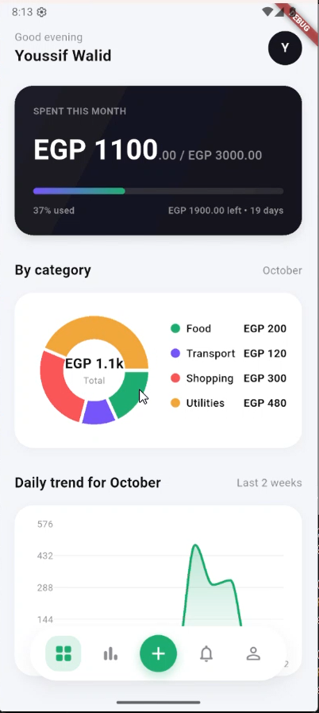
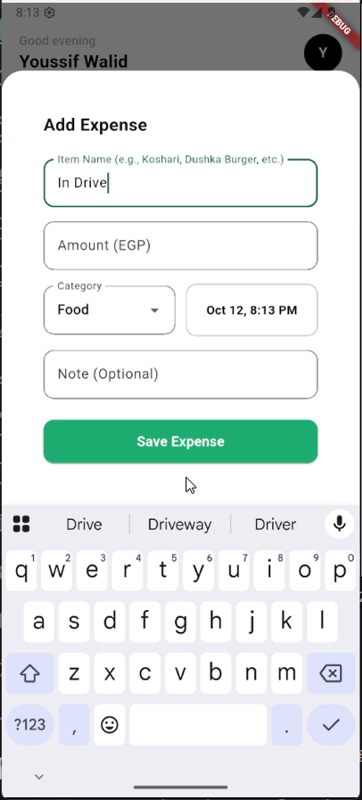
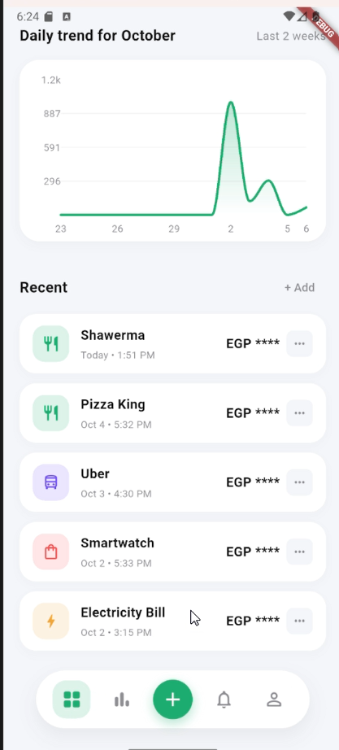
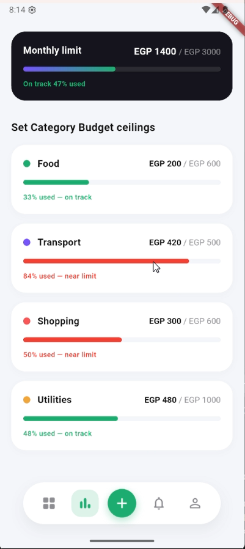

# Masroufi - Expense Tracker App 💸

Masroufi is a cross-platform mobile application built with Flutter that helps users seamlessly track their daily expenses, view monthly trends, and manage their budgets effectively. 

Designed with a focus on a responsive UI and offline-first capabilities, the app ensures your financial data is always accessible and securely synced to the cloud.

## ✨ Features

* **Expense Management:** Easily add, edit, or delete daily expenses and assign them to specific categories.
* **Monthly Summaries & Analytics:** Visualize your spending trends with interactive graphs and comprehensive monthly breakdowns.
* **Goal Setting:** Set budget goals and track your progress over time.
* **Privacy Masking:** Hide sensitive financial figures with a quick toggle using `SharedPreferences` for privacy in public spaces.
* **Offline-First & Cloud Sync:** Robust offline caching ensures the app works without an internet connection, automatically syncing to Firebase Cloud Firestore once reconnected.

## 🛠️ Tech Stack & Architecture

* **Framework:** Flutter (Dart)
* **State Management:** Provider
* **Backend & Database:** Firebase Cloud Firestore
* **Local Storage / Caching:** SQLite & Shared Preferences
* **Architecture:** MVP-driven approach transitioning into a scalable, multi-screen architecture.

## 🚀 Development Phases

This project was developed iteratively across four major phases:

1. **Planning & MVP:** Defined functional requirements, relational data models, and built the initial wireframes for a responsive UI. Implemented core CRUD operations for expenses.
2. **Development & Testing:** Core logic implementation and unit testing.
3. **Analytics & Persistence:** Added multi-screen navigation, monthly summary graphs, user trend discovery, and persistent settings (Toggling Privacy Mode).
4. **Cloud Integration & State Management:** Refactored state management using `Provider`, migrated data persistence to a Firebase backend, and applied offline caching strategies.

## 📱 Screenshots

<div align="center">
  <table>
    <tr>
      <td align="center"><b>Home Dashboard</b></td>
      <td align="center"><b>Add Expense</b></td>
    </tr>
    <tr>
      <td></td>
      <td></td>
    </tr>
    <tr>
      <td align="center"><b>Trends & History</b></td>
      <td align="center"><b>Category Budgets</b></td>
    </tr>
    <tr>
      <td></td>
      <td></td>
    </tr>
  </table>
</div>

## ⚙️ Getting Started

### Prerequisites
* Flutter SDK (latest stable version)
* Dart SDK
* A Firebase project configured for Android/iOS.

### Installation

1. Clone the repository:
   ```bash
   git clone [https://github.com/yourusername/masroufi.git](https://github.com/yourusername/masroufi.git)